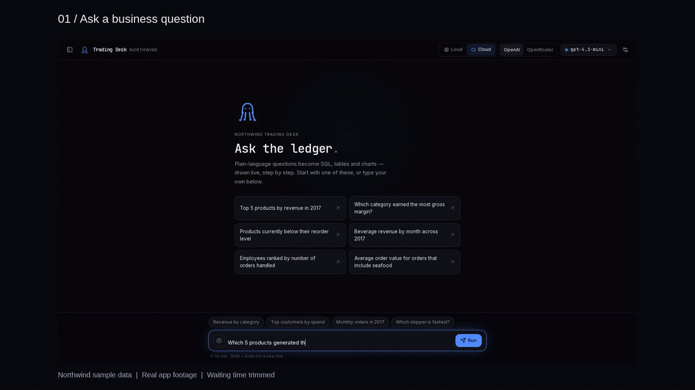
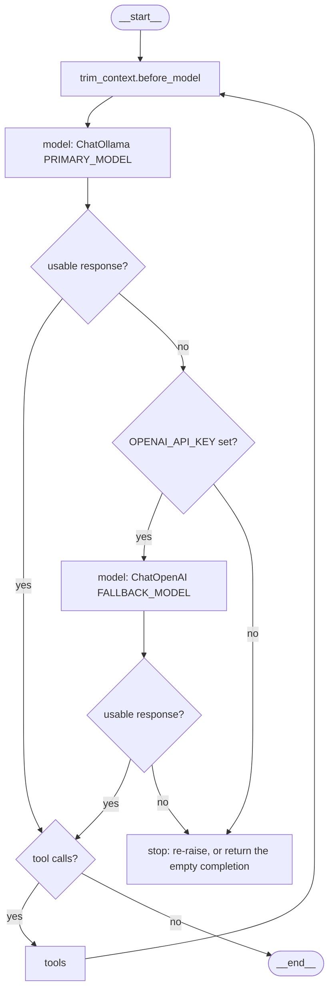

# Northwind Copilot

[](https://github.com/mostafa7arafa/northwind-copilot/actions/workflows/ci.yml)
[](LICENSE)
[](https://www.python.org/downloads/release/python-3120/)

A local-first natural-language-to-SQL agent over the Northwind retail database.
Ask a question in plain English; the agent lists tables, reads the schema,
consults an internal knowledge base, writes SQL, runs it, and answers with the
numbers — never inventing figures. It runs primarily on a local Ollama model
(`gemma4-12b`) and only escalates to a cloud model (`gpt-4.1-mini` on OpenAI)
when the local one fails or returns nothing usable.

It ships three ways to use it:

- a **LangGraph agent** (`langgraph dev`),
- a **FastAPI + Next.js web app** — the "Northwind Trading Desk" (see
  [WEBAPP.md](WEBAPP.md)),
- a **benchmark harness** that grades the agent against a labelled dataset.

<!-- DEMO GIF: docs/assets/demo.gif (15s Trading Desk recording, cloud mode) -->
<!--  -->

## Results at a glance

23 scenarios / 69 turns per arm. Higher is better for the judged metrics.
Local `gemma4-12b` against cloud `gpt-4.1-mini`.

| | `gemma4-12b` (local) | `gpt-4.1-mini` (cloud) |
| --- | --- | --- |
| **correctness** | **89.9%** | **90.6%** |
| **no_hallucination** | **98.6%** | **98.6%** |
| **context_retention** | **91.3%** | 87.0% |
| correctness — turn 1 | 82.6% | 90.9% |
| correctness — turn 2 | 95.7% | 91.3% |
| correctness — turn 3 | 91.3% | 91.3% |
| latency / turn | 6.98 s | 5.69 s |
| latency / conversation | 20.94 s | 17.07 s |
| input tokens / conversation | 12,594 | 21,886 |
| output tokens / conversation | 553 | 712 |
| model calls / conversation | 8.5 | 9.6 |
| cost / 1,000 conversations | **$0** | ~$9.89 |

The machine, the judge, what the gaps do and don't support, and how to
reproduce the run are in
[Evaluation](#evaluation-can-a-local-model-actually-do-this-job).

---

## Architecture

`langgraph.json` compiles `northwind_copilot/query/graph.py:graph`
(`create_agent`). Besides `__start__` and `__end__`, the compiled graph has
three nodes: `trim_context.before_model`, `model`, and `tools`. Local-to-cloud
escalation is not its own node.
`EscalateToFallbackMiddleware.wrap_model_call` runs inside `model`: it calls
Ollama first, and calls OpenAI only when that call raises or returns an empty
completion (no text and no tool call). With no `OPENAI_API_KEY`,
`build_fallback_model` returns `None` and there is nothing to escalate to.



The diamonds are that middleware decision, drawn so the escalation path is
visible. They are not extra LangGraph nodes. On the stop path the middleware
re-raises only when every model raised and none returned a message; an empty
completion is returned instead, and the loop ends because that message has no
tool call. `tools` is a single node. On this static graph it exposes
`sql_db_list_tables`, `sql_db_schema`, `sql_db_query`, `sql_db_query_checker`,
and `search_docs` (FAISS over `docs/*.md`).

Everything Python lives in the single package `northwind_copilot/`, split into
concern-focused layers. Dependencies point **inward**: `web` → `response` →
`query` → `infra` → `core`; nothing in `core` imports anything above it.
`core` is config, KPI definitions, and prompts. `infra` is the database, the
Ollama and OpenAI factories, and the doc index. `query` is the graph, the
per-request engine builder (`ollama`, `openai`, or `openrouter`), and the
middleware. `response` turns a finished turn into a table, a chart, and SSE
events. `web` is the FastAPI service. `eval` is the benchmark harness. The
Next.js Trading Desk lives in `frontend/`; the knowledge base is `docs/`; the
database is `data/northwind.sqlite` (orders span 2012–2023, not classic
1996–98).

### Key design decisions

- **Local-first, escalate-on-empty.** The local model sometimes returns an empty
  completion on the hardest reasoning steps; the agent loop would read that as
  "done" and stop silently. `EscalateToFallbackMiddleware` escalates on an
  exception **or** a degenerate (empty) response — something the stock
  `ModelFallbackMiddleware` misses.
- **The cloud fallback is optional.** With no `OPENAI_API_KEY`, the graph still
  builds and runs entirely on the local model — the escalation simply has no
  target. (`ChatOpenAI` raises at construction without a key, so the factory
  returns `None` instead.)
- **Lean-local / heavy-cloud split (web path).** A slow local model pays real
  latency for every rule and tool round-trip, so the local prompt is short and
  drops the LLM-backed SQL query-checker; cloud carries the full prompt and
  charting instructions. The static benchmark graph is unchanged.
- **Never invent numbers.** Prompts forbid fabricating figures; an empty result
  is reported as "no rows", and the web layer suppresses any chart for it.

---

## Quickstart

Requires **Python 3.12+** and [uv](https://docs.astral.sh/uv/). Local inference
also needs [Ollama](https://ollama.com/) running with `gemma4-12b` pulled. To
skip the GPU, use [Cloud-only](#cloud-only-no-gpu) below.

```bash
uv sync --group dev --group web
cp .env.example .env                  # then edit — see "Configuration" below
```

### Cloud-only (no GPU)

The static graph always constructs an Ollama primary
(`build_primary_model`). You do not need a GPU if a cloud key is set: a failed
or empty local call escalates inside `model`. The Trading Desk can skip Ollama
entirely by choosing the OpenAI engine, which never builds the local model.

From [`.env.example`](.env.example):

| Variable | Needed without Ollama |
| --- | --- |
| `OPENAI_API_KEY` | Required. Builds the OpenAI fallback and the RAG embeddings. |
| `FALLBACK_MODEL` | Cloud model the static graph escalates to. Default `gpt-4.1-mini`. |
| `EMBEDDING_MODEL` | OpenAI embeddings for `search_docs`. Default `text-embedding-3-small`. Uses the same `OPENAI_API_KEY`. |
| `APP_AUTH_TOKEN` | Optional. When it is blank, the web API will not spend the server's `OPENAI_API_KEY` for an anonymous caller — paste a key in the Trading Desk settings, or set this token. |

`PRIMARY_MODEL` and `OLLAMA_BASE_URL` are unused once you select the OpenAI
engine in the web app. A second cloud provider, OpenRouter, reads
`OPENROUTER_API_KEY`. That name is not in the root `.env.example` (it is in
[`deploy/.env.example`](deploy/.env.example)); the root configuration table
lists it for the multi-turn judge.

```bash
uv run langgraph dev                  # Ollama is tried first; errors escalate
# or the web app, then pick OpenAI in the header (see Usage)
```

### Windows notes

- `uv` needs `--native-tls` to reach PyPI:
  `uv sync --group dev --group web --native-tls`.
- Set `PYTHONIOENCODING=utf-8` before commands that print query results. Some
  product and customer names carry accented characters that crash the Windows
  console.

### Run tests

```bash
uv sync --frozen --group dev --group web && uv run pytest
```

The suite runs fully offline — no LLM or network calls.

---

## Usage

### Run the agent (LangGraph dev server)

```bash
uv run langgraph dev
```

`langgraph.json` points at `northwind_copilot/query/graph.py:graph`.

### Run the web app

The full-stack "Trading Desk" (FastAPI backend + Next.js frontend) has its own
guide: **[WEBAPP.md](WEBAPP.md)**. In short:

```bash
# backend (repo root)
LANGCHAIN_TRACING_V2=false \
  uv run uvicorn northwind_copilot.web.app:app --port 8000
# frontend (in ./frontend)
npm install && npm run dev            # http://localhost:3000
```

### Run the benchmark

```bash
uv run python -m northwind_copilot.eval.run_benchmark
uv run python -m northwind_copilot.eval.run_benchmark --id sql_employee_count_usa
uv run python -m northwind_copilot.eval.run_benchmark --limit 3 --no-save
```

Results (accuracy, which model answered, latency) are written to
`eval/results/latest.json`. On Windows, set `PYTHONIOENCODING=utf-8` first
([Windows notes](#windows-notes)).

---

## Evaluation: can a local model actually do this job?

The project ships two ways — run it locally on Ollama, or deploy it against
cloud models. That bet only holds if the local model is genuinely competent, so
we measured it instead of assuming.

### The experiment

**23 scripted three-turn conversations** (69 turns) over the Northwind database,
run identically against both engines. Later turns refer back to earlier ones
("break *that one* down by quarter", "and the worst?", "which of *them* sold
most?"), because reference resolution is the thing a single-turn benchmark
cannot see: 44 of the 69 turns carry an anaphor.

Ground truth is **computed, never hand-written** — every turn carries a reference
SQL query, executed against the live database at dataset-build time. The builder
refuses to publish if a reference query returns no rows (except the one probe
that is *supposed* to), and a test rejects any reference whose `ORDER BY … LIMIT 1`
is tied, since a tie makes two answers correct while marking one of them wrong.

Scored by an LLM judge (`openevals`) on three dimensions, plus latency and tokens
recorded directly:

| Metric | What it asks |
| --- | --- |
| `correctness` | Does the answer match the computed ground truth? |
| `no_hallucination` | Does every figure trace back to a query result this conversation actually retrieved? |
| `context_retention` | Does each "that product" / "their revenue" resolve to the right entity? |

The judge is **`qwen/qwen3-30b-a3b-instruct-2507`** via OpenRouter — a third
family, chosen so it shares no lineage with either arm. (A GPT judge would favour
the GPT arm; Gemini was disqualified for sharing a family with Gemma.)

### The machine

| | |
| --- | --- |
| CPU | AMD Ryzen 9 5900HX (8C/16T, 3.30 GHz) |
| RAM | 32 GB |
| GPU | NVIDIA RTX 3080 Laptop, **16 GB VRAM**, driver 592.00 |
| OS | Windows 11 |
| Runtime | Ollama 0.31.1 |
| Local model | `gemma4-12b` (11.9B, Q4_K_M, 8.3 GB resident, `num_ctx=8192`, **100% GPU**, thinking off) |
| Cloud model | `gpt-4.1-mini` |

### Results

23 scenarios / 69 turns per arm. Higher is better for the judged metrics.

| | `gemma4-12b` (local) | `gpt-4.1-mini` (cloud) |
| --- | --- | --- |
| **correctness** | **89.9%** | **90.6%** |
| **no_hallucination** | **98.6%** | **98.6%** |
| **context_retention** | **91.3%** | 87.0% |
| correctness — turn 1 | 82.6% | 90.9% |
| correctness — turn 2 | 95.7% | 91.3% |
| correctness — turn 3 | 91.3% | 91.3% |
| latency / turn | 6.98 s | 5.69 s |
| latency / conversation | 20.94 s | 17.07 s |
| input tokens / conversation | 12,594 | 21,886 |
| output tokens / conversation | 553 | 712 |
| model calls / conversation | 8.5 | 9.6 |
| cost / 1,000 conversations | **$0** | ~$9.89 |

**The local model is not meaningfully behind.** The correctness gap is 0.7
percentage points — one turn out of 69, well inside the noise of n=23. Both arms
ground their numbers equally well (98.6%), and the local model *leads* on context
retention. It is 1.3 s/turn slower and uses 43% fewer input tokens, because the
local engine runs the lean prompt.

Where they differ is instructive rather than damning:

- `gpt-4.1-mini` is stronger on **turn 1** (90.9% vs 82.6%) — the cold, unanchored
  question. Once the conversation gives the local model a referent to hold, it
  matches or beats the cloud on turns 2 and 3.
- On the out-of-range-year probe (`missing_year_1997`, where the data starts in
  2012), the cloud model correctly says no records exist. The local model answers
  *"total revenue for 1997 was 0"* — it **did not fabricate** (its groundedness
  scored 1.0, and its own insight line says "no orders were recorded"), but
  reporting `0` implies zero sales rather than no data. A real, if subtle, failure.
- `yoy_2016_2017` defeats **both** arms (33% / 50%). Multi-step year-over-year
  deltas per category are the hard case here, not a local-model weakness.

### Reproduce

```bash
# 1. build ground truth from the DB and publish the dataset
uv run python -m northwind_copilot.eval.multiturn.build_dataset --push

# 2. run each arm (writes a LangSmith experiment + full traces)
uv run python -m northwind_copilot.eval.multiturn.run_experiment --arm local
uv run python -m northwind_copilot.eval.multiturn.run_experiment --arm cloud

# 3. side-by-side table
uv run python -m northwind_copilot.eval.multiturn.compare <local-exp> <cloud-exp>
```

Needs `LANGSMITH_API_KEY`, `OPENAI_API_KEY` (cloud arm), and `OPENROUTER_API_KEY`
(judge). Experiments and per-turn traces land on the LangSmith dataset
`northwind-multiturn-analyst`.

### What the numbers do and don't support

- **n = 23.** A proportion is resolved to roughly ±10 points. Read the gaps, not
  the decimals: "indistinguishable on correctness" is supported; "the local model
  is 0.7% worse" is not.
- **The local arm runs with the cloud fallback disabled.** `build_agent_for`
  normally attaches `EscalateToFallbackMiddleware`, which would let `gpt-4.1-mini`
  silently answer gemma's failed turns — the arm would measure a hybrid.
- **Each arm uses the prompt the product actually gives it** (lean for local, full
  analyst prompt for cloud). This compares the two engines *as shipped*, not the
  same prompt on two models.
- **Latency is not apples-to-apples.** The local number is GPU compute on the
  machine above; the cloud number includes network round-trips from Egypt and
  depends on OpenAI's load.
- Cloud cost uses this repo's own rate card ([`metering/pricing.py`](northwind_copilot/metering/pricing.py)):
  $0.40/$1.60 per 1M input/output tokens.

### Why the local model is configured the way it is

Two findings from profiling this hardware, both encoded as defaults in
[`infra/llm.py`](northwind_copilot/infra/llm.py):

1. **Thinking is off.** Chain-of-thought cost **2.5× latency for identical
   accuracy** on the SQL benchmark (26.4 s → 10.5 s average; 9/11 correct either
   way, failing the same two questions).
2. **`num_ctx` is pinned to 8192.** Ollama defaults to 4096 regardless of what the
   model supports and truncates over-long prompts *from the head* — silently
   discarding the system prompt. Verified: at 4096 the model ignored a system rule
   that it obeyed at 8192.

Generation runs at ~45 tok/s, which is ~80% of this GPU's theoretical memory
bandwidth (448 GB/s spec sheet, 8 GB of weights streamed per token). **The GPU is
already saturated** — local speed is a function of model size, not runtime choice,
so swapping Ollama for another llama.cpp wrapper buys nothing.

---

## Configuration

All settings resolve from environment variables (loaded from `.env`) with sane
defaults in [`core/config.py`](northwind_copilot/core/config.py):

| Variable | Default | Purpose |
| --- | --- | --- |
| `PRIMARY_MODEL` | `gemma4-12b` | Local-first Ollama model |
| `FALLBACK_MODEL` | `gpt-4.1-mini` | Cloud escalation model |
| `EMBEDDING_MODEL` | `text-embedding-3-small` | OpenAI embeddings for RAG |
| `NORTHWIND_DATABASE_URI` | `sqlite:///data/northwind.sqlite` | The database |
| `DOCS_DIR` | `docs` | Markdown knowledge base |
| `FAISS_PATH` | `.faiss_index` | On-disk vector index |
| `REINDEX` | `false` | Rebuild the FAISS index on next load |
| `OPENAI_API_KEY` | — | Enables the fallback **and** RAG embeddings |
| `OLLAMA_NUM_CTX` | `8192` | Local context window — see the warning below |
| `OLLAMA_REASONING` | `false` | Chain-of-thought on local thinking models |
| `OLLAMA_NUM_PREDICT` | `1024` | Cap on tokens generated per model call |
| `OLLAMA_KEEP_ALIVE` | `30m` | How long Ollama keeps the model resident |
| `OPENROUTER_API_KEY` | — | Required only by the multi-turn eval's judge |

> **Do not** use `DATABASE_URI` — LangGraph reserves that name for its own
> persistence layer and overwrites it with `:memory:` under `langgraph dev`.
> The RAG `search_docs` tool uses OpenAI embeddings, so questions about
> KPIs/categories/policies need `OPENAI_API_KEY` set even on the local engine.

> **Never lower `OLLAMA_NUM_CTX` below the trim budget** (`max_context_tokens`,
> 8000). Ollama's own default is 4096 and it truncates an over-long prompt
> *silently, from the head* — where the system prompt lives. The agent then
> loses its instructions mid-conversation with no error. This is a correctness
> setting, not a performance one.

---

## Development

```bash
# Test suite (offline — no LLM or network calls)
uv run pytest

# Coverage (branch coverage; 72%+ per module, ~94% overall)
uv run pytest --cov --cov-report=term-missing

# Lint gate (run before shipping)
uv run isort . && uv run black . && uv run flake8 northwind_copilot tests
```

Every module is unit-tested with fakes so the suite never touches Ollama,
OpenAI, or the network. `run_sql` and `build_database` run against the real
`northwind.sqlite` **read-only**.

The multi-turn eval's *instrument* is tested too
([`tests/test_multiturn_eval.py`](tests/test_multiturn_eval.py)): every reference
query must execute, return rows (unless it is the empty-result probe), and resolve
to an unambiguous top-1 answer. A silently wrong reference does not fail an
experiment — it produces a confident, wrong comparison, which is worse.

---

## License

[MIT](LICENSE). Copyright 2026 Mostafa Arafa. The software is provided as-is
and may be used for educational and evaluation purposes.
